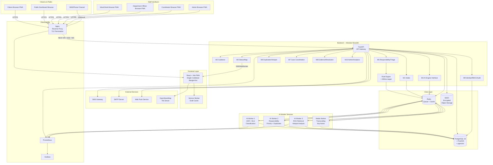
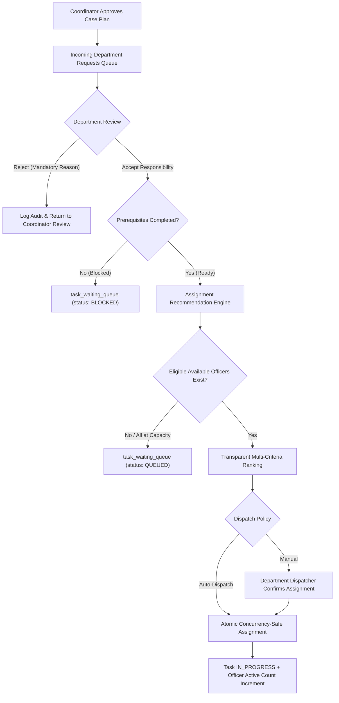

# 03 — System Architecture
## Nagorik Sathi AI — R&D Report v1.2

> Architecture derived from R&D §7. **[PROPOSED]** = decisions not specified by R&D.

---

## 1. Architecture Overview (R&D §7.1)

Nagorik Sathi AI uses a **layered modular-monolith** application (Python FastAPI) for transactional case workflows, plus **separate AI worker services** connected through a message queue.

**Rationale (R&D §7.1):** A modular monolith is preferred over microservices at this stage because:
- Reduces operational complexity and attack surface for a small team
- Clear module boundaries (M1-M10) allow later extraction into services
- Department master data stays in departments' own systems; the platform reaches it only through approved connections

---

## 2. Technology Stack (R&D Table 15)

| Layer | Technology | Purpose |
|-------|-----------|---------|
| Frontend | React + Vite PWA; Bangla-first UI; Bengali web font; Leaflet/MapLibre + OpenStreetMap | One codebase for citizen, ward-desk and admin views; live incident map; location confirmation |
| Backend | Python 3.11, FastAPI, SQLAlchemy, Pydantic | Typed, fast API layer; direct reuse of Python AI ecosystem |
| Database | PostgreSQL 16 with PostGIS | ACID case data; ward boundaries, asset geometry and spatial queries |
| Geospatial prep | geopandas, Shapely, QGIS | Preparing ward boundaries and asset-ownership layers for registry |
| AI services | Python, PyTorch, ONNX Runtime, Transformers (Bangla-capable models), Bangla ASR and OCR | Voice-to-text, request understanding, classification and (phase 2) photo assist |
| Retrieval (RAG) | pgvector plus keyword search over verified service documents | Answers grounded in retrieved, dated, area-tagged sources |
| Messaging and cache | Redis (queue, cache); RabbitMQ optional | Async AI jobs, retries, rule-set and registry caching |
| Object storage | MinIO / S3-compatible, encrypted | Photos, videos, voice recordings, evidence files, application documents |
| Media and real-time | ffmpeg (video transcoding, key-frame extraction); client-side compression; resumable upload; SSE / WebSocket | Video and photo evidence on weak networks; real-time status and map updates |
| Notifications | SMS gateway, SMTP, web push | Progress alerts and requests for response |
| DevOps | Docker, GitHub Actions CI/CD, Nginx, Prometheus + Grafana | Reproducible deploys, monitoring and alerting |
| Testing | pytest, Playwright, OWASP ZAP, k6 | Unit, end-to-end, security and load testing |

---

## 3. Component Responsibilities

### 3.1 Frontend (React PWA)

**Responsibilities:**
- Five role-specific interfaces sharing one codebase: citizen, ward-desk, department officer, coordinator, admin; plus public dashboard
- Bangla-first rendering with Bengali web font (Hind Siliguri or Noto Sans Bengali) **[PROPOSED]**
- GPS location capture with consent; map-based confirmation (Leaflet/MapLibre + OpenStreetMap)
- Live incident map with real-time status updates via SSE/WebSocket
- Photo/video/voice capture and upload (browser APIs)
- Draft persistence with service worker (IndexedDB) for weak connections **[PROPOSED]**
- Responsive: mobile-first for citizens; desktop-optimised for staff consoles

**Does not:**
- Contain business logic
- Store sensitive data beyond drafts
- Make direct database calls

### 3.2 Backend — Modular Monolith (FastAPI)

**Module structure follows R&D M1-M10:**

```
backend/
  app/
    modules/
      m1_intake/        # Account, consent, intake endpoints, upload initiation
      m2_guidance/      # Service list, RAG query endpoint, readiness check
      m3_status/        # Status query, SSE/WebSocket events, notification triggers
      m4_ai_engine/     # AI job submission, result storage (async processing by workers)
      m5_responsibility/ # Rule engine, confidence gate, officer directory lookup
      m6_duplicates/    # Duplicate candidate query, hotspot query
      m7_coordination/  # Case, task, prerequisite, sequencing, escalation
      m8_evidence/      # Evidence upload, resolution review, objection handling
      m9_identity/      # Auth, MFA, roles, consent, audit log
      m10_admin/        # Config, user management, public dashboard aggregation
    core/
      database.py       # SQLAlchemy engine, session management
      security.py       # JWT, password hashing, MFA utilities
      config.py         # Settings via Pydantic BaseSettings
      audit.py          # Audit log writer (append-only)
    api/
      v1/               # Versioned API routes
    workers/
      ai_worker.py      # AI processing jobs (separate process)
      media_worker.py   # Transcoding, transcription jobs
```

**Responsibilities:**
- All transactional case workflow logic (intake through closure)
- Rule engine (deterministic responsibility determination, < 300 ms target)
- Confidence gate enforcement
- RBAC enforcement on every endpoint
- Audit log writes (append-only)
- Emitting SSE/WebSocket events on status changes
- Enqueuing AI jobs to Redis queue
- Receiving AI results from Redis and applying to case

**Does not:**
- Run AI model inference directly in request path (queued to workers)
- Serve media files directly (redirects to MinIO presigned URLs) **[PROPOSED]**

### 3.3 AI Worker Services (separate processes)

**Responsibilities:**
- Consume AI jobs from Redis queue
- Voice-to-text transcription (ASR)
- Bangla text normalisation and entity extraction
- Problem type classification
- Responsibility confidence scoring
- Priority triage
- Duplicate candidate scoring
- Hotspot analysis and review note generation
- RAG retrieval and answer composition
- ONNX Runtime inference with dynamic batching
- Write results back to database via backend API or shared DB connection **[PROPOSED: via backend API to preserve RBAC]**
- Retry with exponential backoff on failure
- Circuit breaker: if AI service down or timeout > 10 s, signal backend to switch to manual mode

**Does not:**
- Expose HTTP endpoints to the public internet
- Make final routing decisions (proposes only)
- Close cases or declare satisfaction

### 3.4 Database (PostgreSQL 16 + PostGIS)

**Responsibilities:**
- Persistent storage for all 5 logical data stores (D1-D5)
- Spatial queries: point-in-polygon (ward lookup), distance-based duplicate candidate search
- pgvector extension for semantic similarity search (RAG)
- Append-only audit log table (partitioned by month) **[PROPOSED]**
- Read replicas for dashboard queries to avoid OLTP contention **[PROPOSED, optional for v1]**

### 3.5 Redis

**Responsibilities:**
- AI job queue (Redis Streams) **[PROPOSED]**
- Media processing job queue
- Rule-set cache (deterministic rules cached in memory, invalidated on config change)
- Officer directory cache
- Ward registry cache
- Rate limiting counters **[PROPOSED]**
- Session tokens (short-lived) **[PROPOSED]**

### 3.6 Object Storage (MinIO)

**Responsibilities:**
- Photo, video, voice recording storage
- Evidence file storage
- All media encrypted at rest (AES-256)
- Presigned URLs for time-limited download (no public access)
- Resumable multipart upload for large files
- Client-facing: chunked upload via backend endpoint; backend issues multipart tokens **[PROPOSED]**

---

## 4. System Architecture Diagram



---

## 5. Data Flow Summary

### 5.1 Synchronous Path (< 300 ms)
1. Request arrives → Nginx → API gateway
2. RBAC check (JWT validation, role + scope verification)
3. Request routed to module
4. Deterministic rule engine (if needed) — reads from Redis cache
5. Database read/write
6. Audit log appended
7. SSE/WebSocket event emitted if status changed
8. HTTP response returned

### 5.2 Asynchronous AI Path
1. Citizen submits report → API returns 202 Accepted + job ID
2. Job enqueued in Redis Streams
3. Frontend shows "Processing..." with job ID for polling/SSE
4. AI Worker dequeues job
5. AI processing (ASR, NLU, classification, confidence scoring)
6. Result written to DB (via API endpoint to preserve RBAC) **[PROPOSED]**
7. SSE event emitted: "AI processing complete — proposal ready"
8. Confidence gate evaluated in backend
9. If gate passed and no critical flag: proposal presented to staff
10. If below gate or critical flag: manual verification queue entry created

### 5.3 Media Upload Path
1. Client requests upload token → API creates multipart upload in MinIO → returns presigned part URLs
2. Client uploads parts directly to MinIO (chunked, resumable) **[PROPOSED]**
3. Media worker job enqueued for transcoding/transcription
4. Media worker processes file, writes metadata to DB
5. Media available for evidence display via presigned download URL

---

## 6. Live Updates (SSE / WebSocket)

- **SSE** (Server-Sent Events): preferred for read-heavy status updates (citizen watching their case)
- **WebSocket**: for staff consoles where bidirectional updates are beneficial
- **[PROPOSED]**: Use SSE as the primary mechanism; WebSocket for the staff map view
- Fallback: polling endpoint `GET /cases/{id}/status` for environments where SSE is blocked

---

## 7. Failure Handling

| Failure Mode | Detection | Response |
|-------------|-----------|----------|
| AI worker timeout (> 10 s) | Circuit breaker in backend | Switch to manual mode; notify user; draft AI result saved when available |
| AI worker crashes | Redis job visibility timeout + dead-letter | Retry (3x, exponential backoff); if exhausted → manual queue |
| Database connection failure | SQLAlchemy pool timeout | Return 503; circuit breaker; log alert |
| MinIO unreachable | HTTP error on upload/download | Return 503; retry; queue upload for later |
| SMS gateway failure | HTTP error | Log; retry; fall back to e-mail if consent given |
| SSE connection dropped | Client reconnects with Last-Event-ID | Server resends missed events from Redis buffer **[PROPOSED]** |
| Rule engine Redis miss | Cache miss detected | Re-read from DB; update cache |

---

## 8. Security Architecture

### 8.1 Network
- All traffic: TLS 1.3 (terminated at Nginx)
- Internal services: private Docker network; no public exposure of DB, Redis, MinIO, workers
- MinIO: access via presigned URLs with TTL; no public bucket

### 8.2 Authentication and RBAC
- JWT tokens (short-lived: 15 min access, 24 h refresh) **[PROPOSED]**
- MFA (TOTP) required for all staff roles
- RBAC enforced at API gateway layer + module layer (defence in depth)
- Ward and department scope embedded in JWT claims **[PROPOSED]**

### 8.3 Data
- AES-256 encryption at rest for media files
- Sensitive citizen fields (phone, e-mail) encrypted at application layer **[PROPOSED]**
- Audit log: append-only Postgres table with trigger preventing UPDATE/DELETE **[PROPOSED]**

### 8.4 Input Validation
- All inputs validated with Pydantic schemas
- File type validation (magic bytes, not just extension) **[PROPOSED]**
- SQL injection: prevented by SQLAlchemy ORM parameterised queries
- XSS: React's default escaping + CSP headers

---

## 9. Deployment Architecture

```
Docker Compose (development / prototype):
  - nginx (reverse proxy, TLS termination)
  - frontend (React build served by Nginx)
  - backend (FastAPI, uvicorn)
  - ai-worker (3 replicas) [PROPOSED: 3 for load in prototype]
  - media-worker (1 replica)
  - postgres (PostgreSQL 16 + PostGIS + pgvector)
  - redis (Redis 7)
  - minio (MinIO)
  - prometheus
  - grafana

GitHub Actions CI/CD:
  - Lint (ESLint, ruff)
  - Type check (mypy, TypeScript)
  - Unit tests (pytest, Vitest)
  - Integration tests
  - Security scan (OWASP ZAP, bandit)
  - Docker build and push
  - Deploy to staging
```

---

## 10. Architecture Decisions Summary

| Decision | Choice | Rationale |
|----------|--------|-----------|
| Monolith vs. microservices | Modular monolith | Specified by R&D; reduces complexity for small team |
| Message queue | Redis Streams (RabbitMQ optional) | R&D specifies Redis required; RabbitMQ optional; Redis Streams sufficient for v1 |
| Map library | MapLibre (alternative: Leaflet) | Both listed by R&D; MapLibre recommended for PWA performance [PROPOSED] |
| Media upload | Chunked to MinIO via backend-issued presigned parts | Security: backend controls access; resilience for weak networks |
| SSE vs. WebSocket | SSE primary; WebSocket for staff consoles | SSE simpler, firewall-friendly for citizen interface |
| AI inference path | Async workers, not in request path | R&D specified: model latency never blocks the UI |
| Audit log | Append-only Postgres table | R&D requires immutable audit; Postgres trigger prevents mutation |

---

## 11. Department Dispatcher, Officer Availability & Persistent Queue Architecture (Explicit Addition)

### 11.1 Department Dispatcher Subsystem


### 11.2 Concurrency & State Safety Mechanisms
- **Atomic Queue Processing**: When officers become available or a dispatcher triggers assignment, transactions use `SELECT FOR UPDATE` on task and officer rows to eliminate capacity race conditions and double-dispatch.
- **Restart-Resilient Queue**: `task_waiting_queue` persists state directly in PostgreSQL/SQLite. Upon service startup, the queue state is fully recovered.
- **Prerequisite Locking Guard**: Dependent tasks (e.g., Road repair) cannot be transitioned out of `BLOCKED` queue status until the upstream prerequisite task (Drain cleaning) completes with verified evidence.

