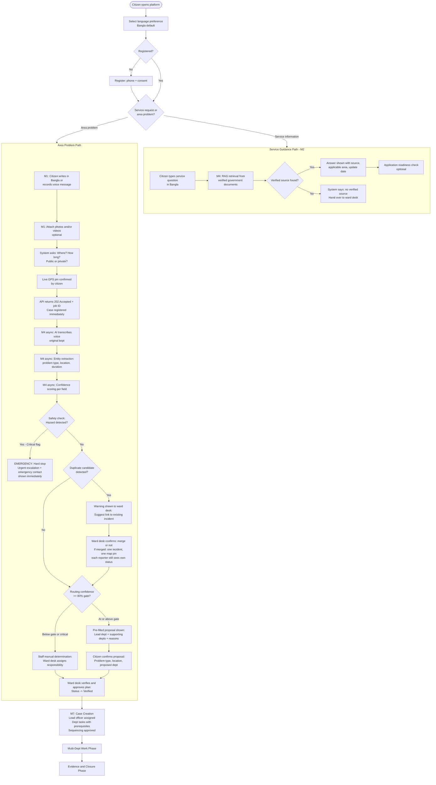
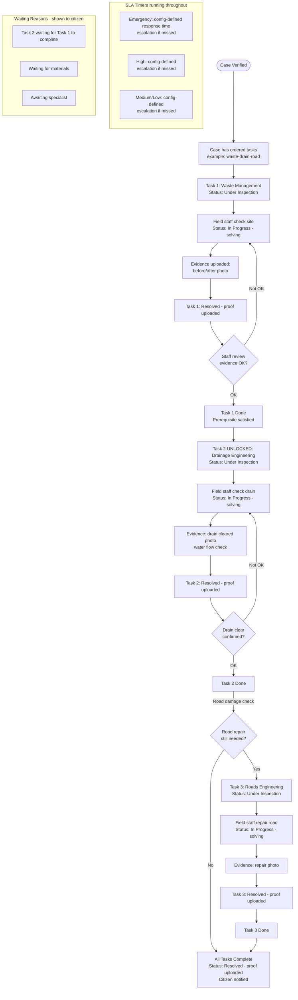
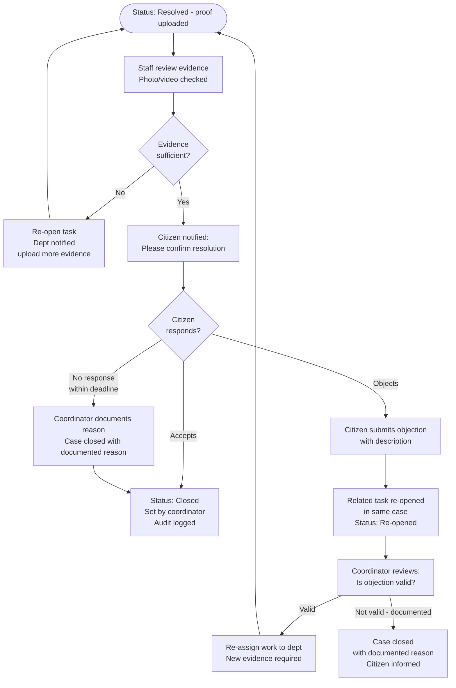
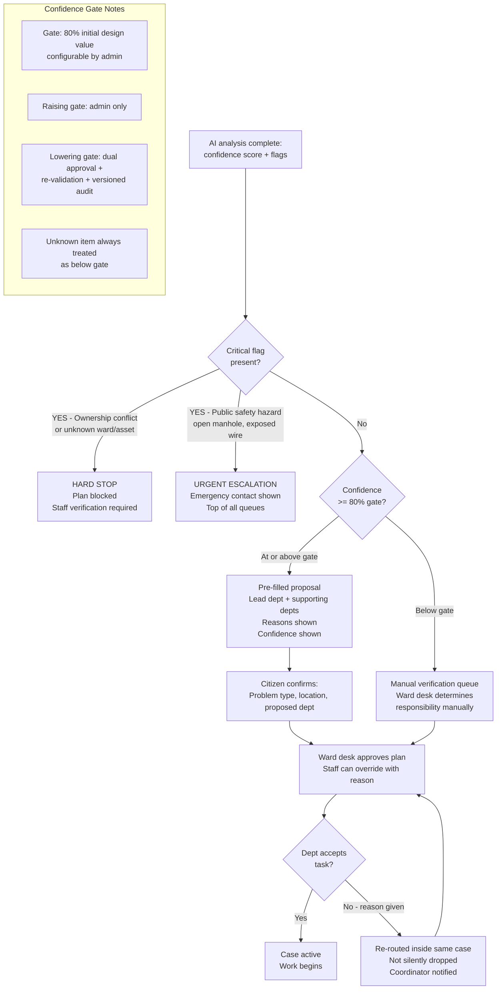
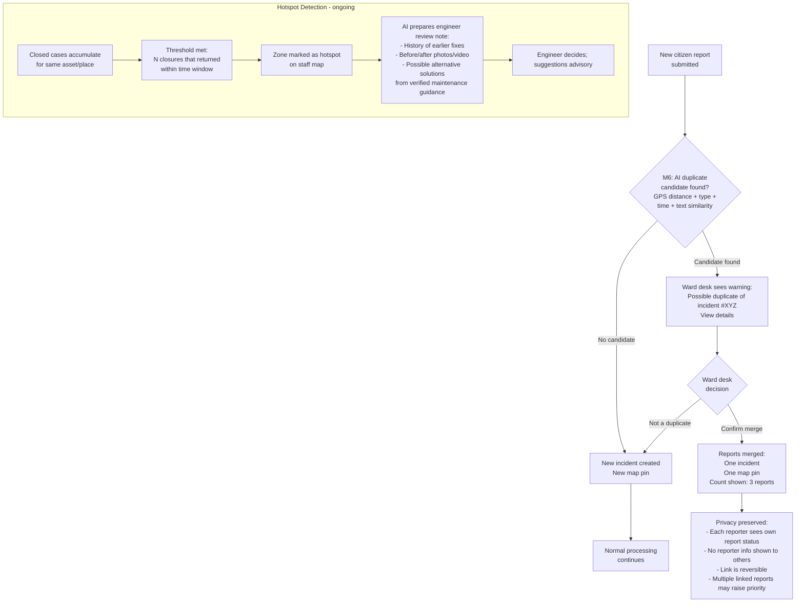
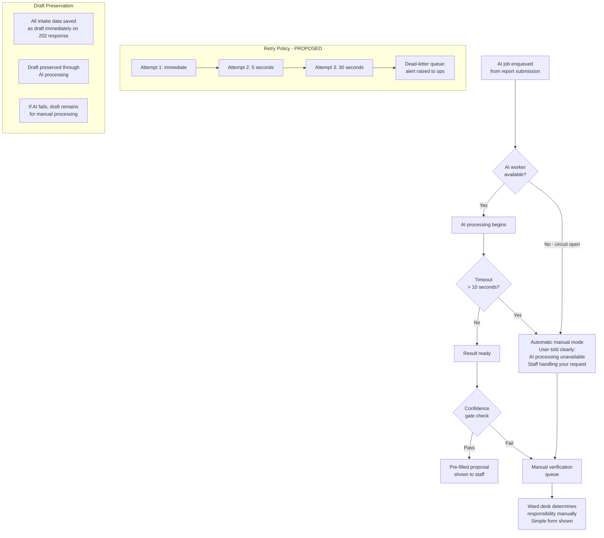
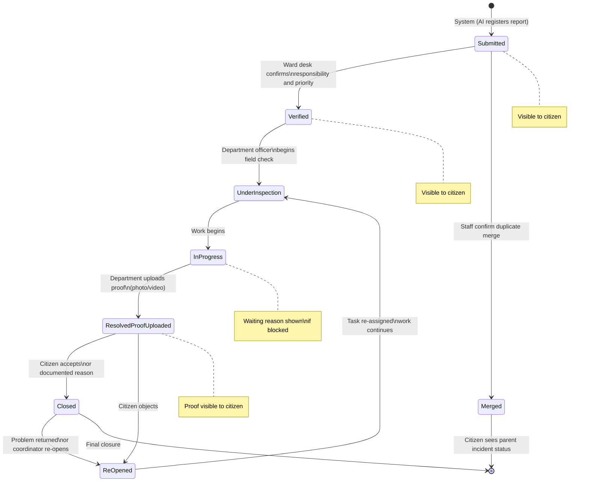
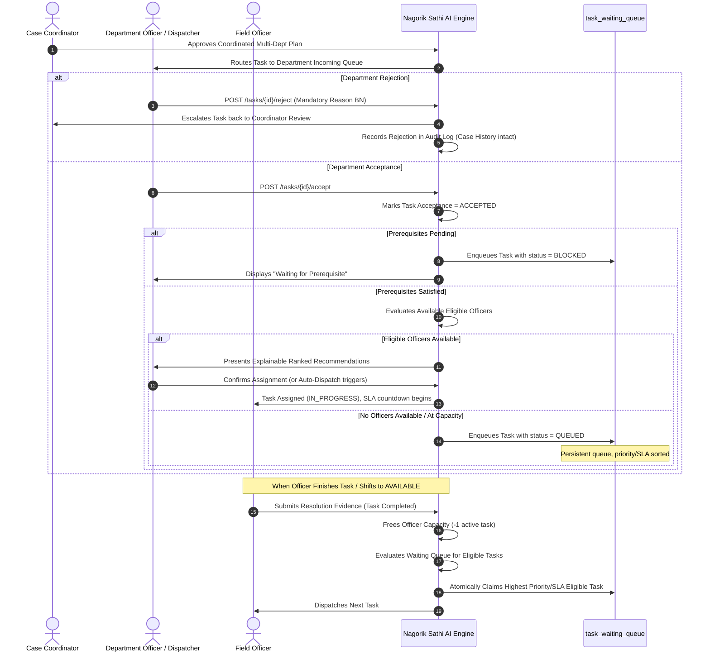

# 04 — End-to-End Workflows
## Nagorik Sathi AI — R&D Report v1.2

> Workflows derived from R&D §6.2 (8-stage flowchart, Figure 1), §6.3 (feature behaviour), §10.3 (responsibility), §10.6 (integrity checks), §10.8 (duplicates), §10.9 (async pipeline), §12.1 (defence in depth), §13 (fallback).

---

## 1. Complete Citizen Journey

The R&D specifies 8 numbered stages, 3 decision points, and 2 alternative paths (service-information path vs. area-problem path; AI-proposed vs. staff-verified responsibility).

---

## 2. Multi-Department Work Phase

---

## 3. Evidence Review and Closure

---

## 4. Routing Confidence and Critical Flag Handling

---

## 5. Duplicate Incident Handling

---

## 6. AI Worker Failure and Manual Fallback

---

## 7. Status Lifecycle Summary

---

## 8. Workflow-to-Module Mapping

| Workflow Stage | R&D Modules | Backend Modules | Key APIs |
|---------------|------------|-----------------|---------|
| Registration and consent | M9 | m9_identity | POST /auth/register, POST /auth/consent |
| Intake (text/voice/media) | M1, M4 | m1_intake, m4_ai_engine | POST /reports, POST /media/upload |
| Service guidance | M2, M4 | m2_guidance | POST /guidance/query |
| Duplicate detection | M4, M6 | m6_duplicates | GET /incidents/duplicates?report_id= |
| Confidence gate and proposal | M4, M5 | m5_responsibility | GET /reports/{id}/ai-proposal |
| Staff verification | M5, M7 | m5_responsibility, m7_coordination | POST /incidents/{id}/verify |
| Case creation and tasks | M7 | m7_coordination | POST /cases, POST /cases/{id}/tasks |
| Multi-dept work | M7, M8 | m7_coordination, m8_evidence | PATCH /tasks/{id}/status |
| Evidence upload | M8 | m8_evidence | POST /tasks/{id}/evidence |
| Citizen notification | M3 | m3_status | SSE /events/stream |
| Resolution review | M8 | m8_evidence | POST /cases/{id}/resolution-review |
| Citizen response | M3, M8 | m3_status, m8_evidence | POST /cases/{id}/citizen-response |
| Closure | M7 | m7_coordination | POST /cases/{id}/close |
| Hotspot analysis | M6 | m6_duplicates | GET /hotspots |
| Escalation | M7, M10 | m7_coordination | POST /cases/{id}/escalate |
| Audit | M9 | m9_identity | GET /audit (admin only) |
| Public dashboard | M10 | m10_admin | GET /public/analytics |

---

## 9. Department Acceptance & Workload-Aware Allocation Workflow (Explicit Addition)

