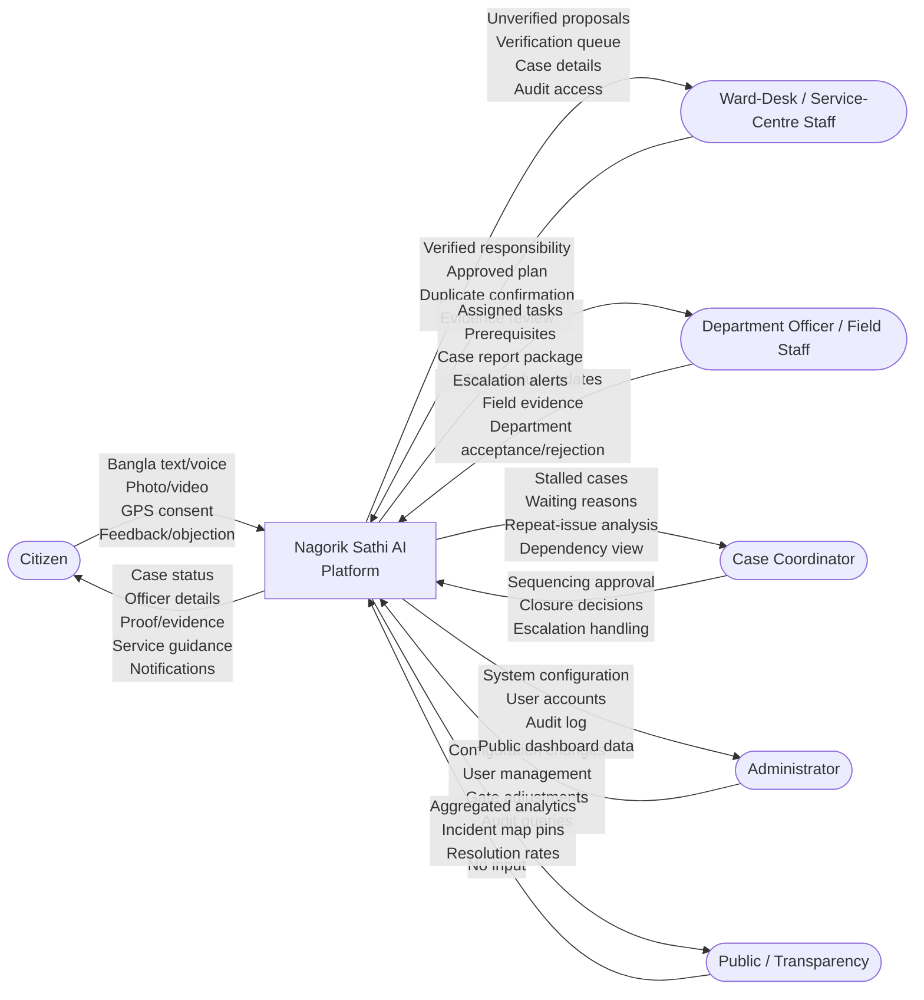
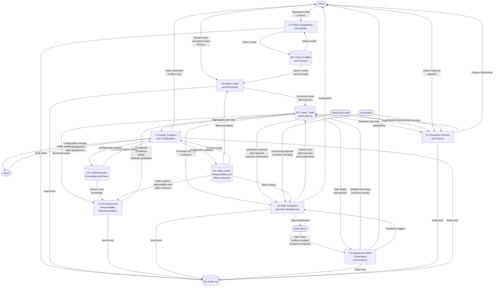
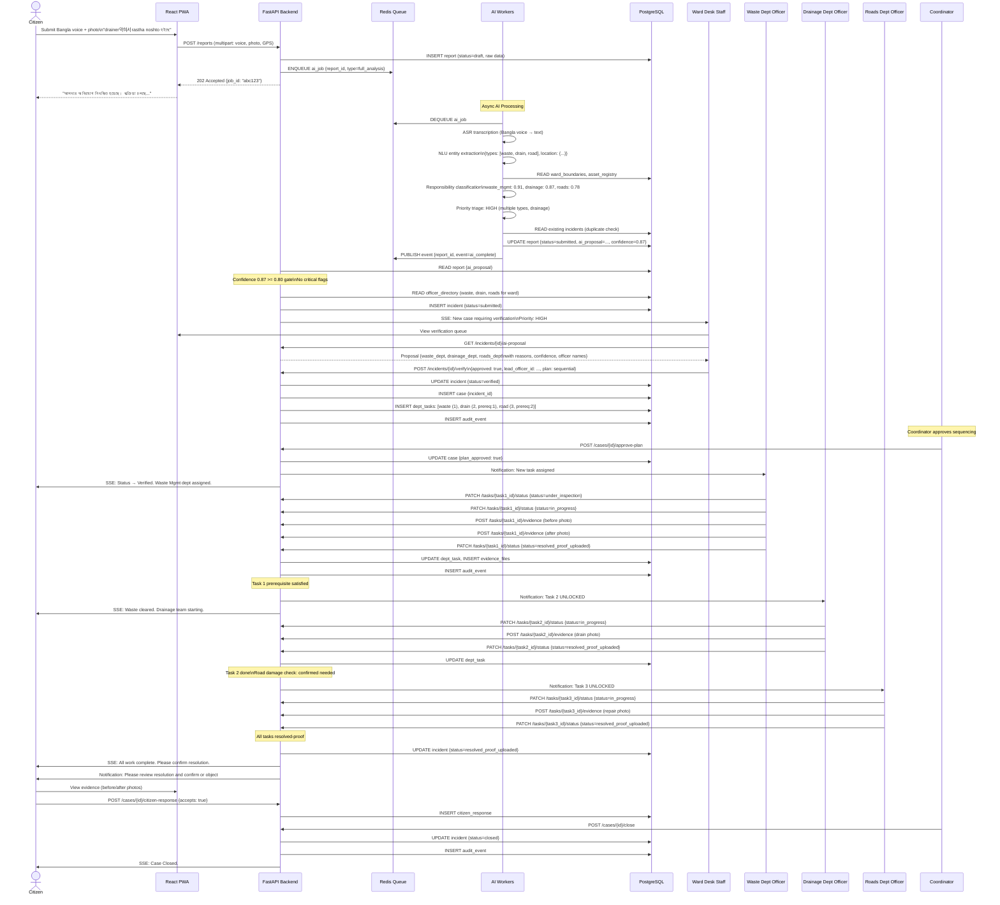
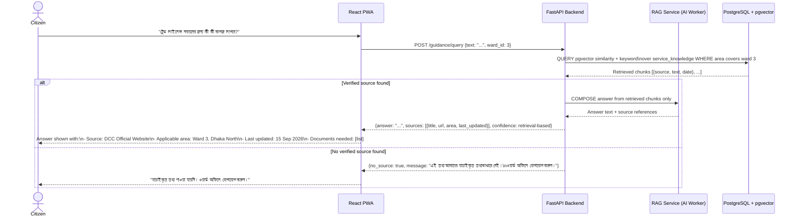
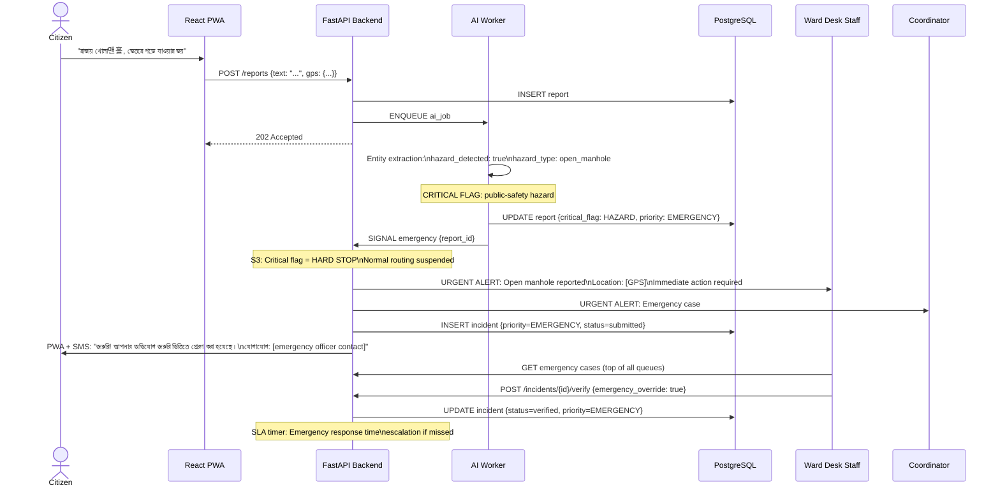

# 05 — DFD and Sequence Design
## Nagorik Sathi AI — R&D Report v1.2

> DFD derived from R&D §8.1 (DFD Level 0, Figure 6), §8.2 (DFD Level 1, Figure 7) and §8.3 (UML sequence).
> The R&D specifies 7 DFD processes and 5 data stores; these are distinct from the 10 application modules (M1-M10). The mapping is explained in Section 4.

---

## 1. DFD Level 0 — Context Diagram (R&D Figure 6)

The context diagram shows Nagorik Sathi AI as one process exchanging data with five external entities.

**External Entities:**
| Entity | Type | Interaction |
|--------|------|-------------|
| E1: Citizen | Human user (authenticated) | Submits reports; receives status, guidance, notifications; confirms or objects to resolution |
| E2: Ward-Desk / Service-Centre Staff | Human user (staff, authenticated) | Verifies proposals; confirms duplicates; approves plans; reviews evidence |
| E3: Department Officer / Field Staff | Human user (staff, authenticated) | Accepts/rejects tasks; updates work status; uploads evidence |
| E4: Case Coordinator | Human user (staff, authenticated) | Approves sequencing; handles escalations; reviews closures |
| E5: Administrator | Human user (admin, authenticated) | Configures system; manages users; reviews audit |
| E6: Public | Anonymous browser | Views aggregated public dashboard and incident map |

---

## 2. DFD Level 1 — Processes and Data Stores (R&D Figure 7)

Level 1 decomposes the platform into seven processes and five data stores. Process 3.0 is the AI analysis and responsibility recommendation engine; every process also writes events to D5 (audit log).

---

## 3. Data Stores — Logical Groupings (R&D §8.2)

The five logical data stores are architectural groupings, not five physical tables.

| Store | Contents | Primary Tables (see ERD) | Access Pattern |
|-------|----------|--------------------------|----------------|
| D1: Citizen Profiles and Consent | User accounts, role assignments, consent records, contact preferences | users, citizen_profiles, consent_records, notification_preferences | Auth system, M1, M9 |
| D2: Cases, Tasks and Evidence | Reports, incidents, coordinated cases, dept tasks, prerequisites, priority history, status history, duplicate relationships, evidence, resolution reviews, citizen responses, AI jobs and results | reports, incidents, cases, dept_tasks, task_prerequisites, priority_history, status_history, duplicate_links, evidence_files, resolution_reviews, citizen_responses, ai_jobs | M1, M4-M8 |
| D3: Verified Service Knowledge and Rules | Service information items, source metadata, embeddings (pgvector), responsibility rules, SLA policies, configuration | service_knowledge, knowledge_sources, responsibility_rules, sla_policies, system_config | M2, M5, M10 |
| D4: Ward, Asset, Responsibility and Officer Directory | Ward boundaries (PostGIS geometry), asset registry (PostGIS geometry), department definitions, officer directory, backup officers | wards, assets, departments, officers, officer_ward_assignments | M5, M6, M7 |
| D5: Audit Log | Append-only log of every state change and access event; every process writes here | audit_events | M9, M10 (read-only for admin) |

---

## 4. Mapping: DFD 7 Processes vs. Application 10 Modules

The R&D specifies 7 DFD processes (data-flow decomposition) and 10 application modules (functional decomposition). These are different views of the same system and must not be conflated.

| DFD Process | Description | Application Module(s) | Notes |
|-------------|-------------|----------------------|-------|
| P1: Citizen Registration and Identity | Account creation, consent, authentication | M9 Identity/RBAC/Consent/Audit | M9 spans all processes for audit |
| P2: Report Intake and Structuring | Text/voice/media intake, GPS, structuring | M1 Intake | M4 AI processing is triggered by P2 but runs async |
| P3: AI Analysis and Responsibility Recommendation | AI classification, entity extraction, confidence scoring, duplicate detection, priority triage | M4 AI Intake/Analysis Engine, M5 Responsibility/Triage, M6 Duplicate/Hotspot | P3 = async AI worker layer |
| P4: Staff Verification and Case Management | Verification queue, plan approval, case creation, sequencing, officer lookup | M5 (verification), M7 Case Coordination | Includes coordinator approval |
| P5: Department Work Coordination and Evidence | Task assignment, status updates, evidence upload, escalation | M7 (task side), M8 Evidence/Resolution | M8 handles evidence, M7 handles task flow |
| P6: Resolution Review and Closure | Evidence review, citizen notification, objection handling, closure | M8 Evidence/Resolution, M3 Status/Map/Notifications | M3 handles notifications from P6 |
| P7: Insight, Analytics and Configuration | Public dashboard, hotspot analysis, admin configuration, SLA timers | M6 (hotspot), M10 Admin/Analytics | M6 feeds hotspot data to M10 |

**Key insight:** M9 (Identity/RBAC/Audit) cuts across all 7 DFD processes — every process writes to D5 and every process enforces RBAC via M9. This is why M9 does not map 1:1 to any single DFD process.

**Key insight:** The DFD shows P3 as a single AI block. In the application architecture, P3 is distributed across M4, M5, and M6 worker processes. The DFD captures the data-flow view; the modules capture the deployment and code boundary view.

---

## 5. UML Sequence — Multi-Department Scenario (R&D §8.3)

This is the core R&D multi-department scenario: a compound case with waste + drain + road, three departments, task prerequisites.

---

## 6. UML Sequence — Service Information Query (RAG)

---

## 7. UML Sequence — Emergency Escalation

