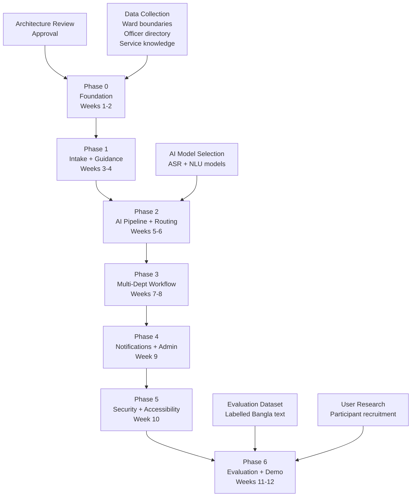

# 13 — Implementation Roadmap
## Nagorik Sathi AI — R&D Report v1.2

> Roadmap derived from R&D §6.1 (12-week plan). Phases start only after architecture review and approval.
> This roadmap is a plan; actual timeline must be validated against development team capacity.

---

## 1. Pre-Phase: Architecture Review and Approval

**Duration:** Before week 1 begins  
**Prerequisite:** Planning package complete (all 15 documents)  
**Deliverables:**
- All planning documents reviewed and approved
- Open questions Q1-Q9 (from 02-scope-and-assumptions.md) resolved
- Specific city corporation and wards confirmed
- Service knowledge items list confirmed
- Technology choices approved (MapLibre vs. Leaflet; SMS gateway; MinIO)

**Acceptance criteria:** No unresolved Critical questions; architecture review sign-off obtained

---

## 2. Phase 0 — Foundation (Weeks 1-2)

**R&D alignment:** "Requirements, system design, data model, initial data collection"

### 2.1 Database Foundation

**Prerequisites:** City corporation and ward data confirmed  
**Files/modules to implement:**
```
backend/
  migrations/
    001_create_extensions.sql       (PostGIS, pgvector, uuid-ossp)
    002_d4_ward_asset_registry.sql  (wards, city_corporations, departments, assets, officers, officer_ward_assignments, responsibility_rules)
    003_d1_identity.sql             (users, citizen_profiles, consent_records, notification_preferences)
    004_d2_cases_tasks.sql          (reports, report_media, incidents, duplicate_links, priority_history, status_history, cases, dept_tasks, task_prerequisites, evidence_files)
    005_d2_ai_jobs.sql              (ai_jobs, ai_results)
    006_d2_resolution.sql           (resolution_reviews, citizen_responses, sla_timers, hotspot_zones)
    007_d3_knowledge.sql            (service_knowledge, knowledge_sources, system_config)
    008_d5_audit.sql                (audit_events — partitioned, trigger for immutability)
    009_spatial_indexes.sql         (GIST indexes on ward.boundary, assets.location, incidents.location)
    010_seed_fixtures.sql           (test ward boundaries, illustrative departments, responsibility rules)
```

**Tests that must pass before moving to Phase 1:**
- IT-GEO-01 to IT-GEO-05 (spatial queries)
- IT-AUD-01, IT-AUD-02 (audit log immutability)
- UT-DM-02, UT-DM-03 (constraint tests)

**Risks:** Ward boundary GeoJSON data not yet available → fixture data used; document clearly as illustrative

### 2.2 Identity and RBAC

**Files/modules to implement:**
```
backend/app/modules/m9_identity/
  auth.py          (JWT generation, MFA, OTP)
  rbac.py          (role definitions, scope enforcement decorators)
  audit.py         (audit_event writer function)
  consent.py       (consent record management)
```

**API endpoints:**
- POST /auth/register
- POST /auth/login
- POST /auth/mfa/verify
- POST /auth/token/refresh

**Tests that must pass:**
- T-RBAC-01 to T-RBAC-13 (all RBAC negative cases)
- T-API-06 (expired JWT)
- SEC-03, SEC-04, SEC-05 (auth security)

### 2.3 Docker and CI

**Files to implement:**
```
docker-compose.yml           (all services)
docker-compose.test.yml      (test isolation)
.github/workflows/ci.yml     (lint, test, build)
nginx/nginx.conf             (TLS, CORS, proxy)
```

---

## 3. Phase 1 — Intake and Service Guidance (Weeks 3-4)

**R&D alignment:** "Foundation: database, authentication, core API endpoints"

### 3.1 Citizen Intake (M1)

**Prerequisites:** Phase 0 complete  
**Files/modules to implement:**
```
backend/app/modules/m1_intake/
  intake.py           (POST /reports, draft management)
  media.py            (POST /reports/{id}/media, MinIO upload)
  location.py         (ward lookup from GPS using PostGIS)
```

**Frontend screens:**
- S-CIT-01 (Registration)
- S-CIT-02 to S-CIT-05 (Report Wizard)
- S-CIT-06 (My Reports list)

**Tests that must pass:**
- T-API-01, T-API-02, T-API-03 (intake validation)
- CT-FE-03 (submit disabled without location)
- FR-07 (offline draft)
- FR-08 (resumable upload)

### 3.2 Service Guidance (M2)

**Files/modules to implement:**
```
backend/app/modules/m2_guidance/
  guidance.py         (POST /guidance/query, GET /guidance/services)
  rag.py              (pgvector query, hybrid retrieval, answer composition)
```

**Data required:** 10-15 verified service knowledge items ingested into D3  
**Frontend screens:** S-CIT-09 (guidance search and service list) [screen numbering from sitemap]

**Tests that must pass:**
- IT-VEC-01, IT-VEC-02 (RAG retrieval)
- E2E-08 (guidance query end-to-end)

### 3.3 Public Map and SSE

**Files/modules to implement:**
```
backend/app/modules/m3_status/
  events.py           (SSE endpoint, event publishing)
  public_map.py       (GET /public/map)
```

**Frontend screens:** S-PUB-02 (Public Map)

**Tests that must pass:**
- T-API-07 (SSE reconnect)
- E2E-09 (public map)
- E2E-11 (SSE real-time update)

---

## 4. Phase 2 — AI Pipeline and Routing (Weeks 5-6)

**R&D alignment:** "Main implementation: intake, routing"

### 4.1 AI Worker Infrastructure

**Prerequisites:** Phase 1 complete; Redis Streams configured  
**Files/modules to implement:**
```
backend/app/workers/
  ai_worker.py        (consume from Redis, dispatch to AI models)
  media_worker.py     (ffmpeg transcoding, ASR)
  circuit_breaker.py  (timeout and manual fallback)

backend/app/modules/m4_ai_engine/
  pipeline.py         (orchestrate all AI stages)
  asr.py              (Bangla ASR)
  nlp.py              (entity extraction, normalisation)
  classifier.py       (problem type classification)
```

**AI models to source [PROPOSED]:**
- ASR: Whisper-large-v3 with Bangla fine-tune or BanglaASR [NEEDS CLARIFICATION: specific model]
- Text classification: BanglaBERT fine-tuned on civic complaint categories [NEEDS CLARIFICATION]
- Embedding: multilingual-e5 or BanglaBERT for duplicate detection [NEEDS CLARIFICATION]

**Tests that must pass:**
- E2E-07 (AI unavailable fallback)
- FR-01, FR-02 (worker failure recovery)
- UT-RE-09 (rule engine latency)

### 4.2 Responsibility and Triage (M5)

**Files/modules to implement:**
```
backend/app/modules/m5_responsibility/
  rule_engine.py      (deterministic: ward lookup, asset lookup, rules)
  confidence_gate.py  (gate evaluation, critical flag check)
  officer_lookup.py   (officer directory query)
  triage.py           (priority scoring)

backend/app/api/v1/
  verification.py     (GET /verification/queue, GET /reports/{id}/ai-proposal, POST /incidents/{id}/verify)
```

**Tests that must pass:**
- UT-RE-01 to UT-RE-08 (rule engine unit tests)
- UT-CG-01 to UT-CG-05 (confidence gate tests)
- UT-PT-01 to UT-PT-05 (priority triage tests)
- E2E-05 (emergency escalation)

### 4.3 Duplicate Detection (M6)

**Files/modules to implement:**
```
backend/app/modules/m6_duplicates/
  duplicate.py        (candidate query, confirmation, merge)
  hotspot.py          (hotspot detection, review note generation)
```

**Tests that must pass:**
- E2E-06 (duplicate merge)

---

## 5. Phase 3 — Multi-Department Workflow (Weeks 7-8)

**R&D alignment:** "Main implementation: multi-department workflow"

### 5.1 Case Coordination (M7)

**Prerequisites:** Phase 2 complete  
**Files/modules to implement:**
```
backend/app/modules/m7_coordination/
  case.py             (case creation, plan approval, closure)
  task.py             (task lifecycle, prerequisite check)
  sequencing.py       (sequencing approval, dependency validation)
  escalation.py       (SLA timer, escalation logic)
  report_package.py   (full report PDF/view generation)
```

**API endpoints:**
- POST /cases, GET /cases/{id}, POST /cases/{id}/approve-plan
- POST /tasks/{id}/accept, POST /tasks/{id}/reject
- PATCH /tasks/{id}/status
- POST /cases/{id}/escalate
- POST /cases/{id}/close

**Frontend screens:**
- S-WARD-02 (Verification Queue)
- S-WARD-03 (Verification Detail)
- S-DEPT-02 (My Tasks)
- S-DEPT-03 (Task Workspace)
- S-COORD-02 (Case List)
- S-COORD-03 (Case Coordination Workspace)

**Tests that must pass:**
- E2E-02 (ward desk verification)
- E2E-03 (multi-department compound case)
- UT-DM-04, UT-DM-05 (task constraint tests)
- T-API-04, T-API-05 (API validation)

### 5.2 Evidence and Resolution (M8)

**Files/modules to implement:**
```
backend/app/modules/m8_evidence/
  evidence.py         (upload, retrieval, masking flag)
  resolution.py       (resolution review, citizen response)
  objection.py        (objection handling, task re-open)
```

**API endpoints:**
- POST /tasks/{id}/evidence, GET /tasks/{id}/evidence
- POST /cases/{id}/resolution-review
- POST /cases/{id}/citizen-response

**Frontend screens:**
- S-CIT-07 (Incident Detail with proof)
- S-CIT-08 (Citizen Response)

**Tests that must pass:**
- E2E-04 (citizen objection and re-review)
- UT-DM-05 (closure without evidence blocked)
- FR-03 (evidence upload retry)

---

## 6. Phase 4 — Notifications, Dashboard and Admin (Week 9)

### 6.1 Notifications (M3)

**Files/modules to implement:**
```
backend/app/modules/m3_status/
  notifications.py    (SMS gateway, SMTP, web push)
```

**Tests that must pass:**
- E2E-01 (notification received after status change)

### 6.2 Admin and Public Dashboard (M10)

**Files/modules to implement:**
```
backend/app/modules/m10_admin/
  config.py           (configuration management, dual-approval gate)
  users.py            (user management)
  knowledge.py        (service knowledge CRUD)
  analytics.py        (aggregated public dashboard data)
  officers.py         (officer directory management)
```

**Frontend screens:**
- S-ADMIN-01 to S-ADMIN-06
- S-PUB-03 (Public Transparency Dashboard)

**Tests that must pass:**
- E2E-10 (admin confidence gate change with dual approval)
- T-RBAC-11, T-RBAC-12 (admin RBAC)
- T-API-08 (no personal data in public analytics)

---

## 7. Phase 5 — Security Hardening, Accessibility and Testing (Week 10)

**Prerequisites:** All features implemented  
**Deliverables:**
- Complete OWASP ZAP security scan on all endpoints
- All RBAC negative test cases pass
- axe-core accessibility audit: all critical violations resolved
- Keyboard-only E2E flow passes
- Load test results: p95 latency targets met or documented gap
- Code review: all security controls in place

**Tests that must pass:**
- SEC-01 to SEC-10
- ACC-01 to ACC-10
- PERF-01 to PERF-05
- FR-01 to FR-08

---

## 8. Phase 6 — AI Evaluation and Demo Preparation (Weeks 11-12)

**R&D alignment:** "Comparative evaluation, report and demo"  
**Prerequisites:** Labelled evaluation datasets prepared; shadow mode running

**Activities:**
- Run AI offline evaluation on held-out Bangla civic text dataset
- Measure classification Macro-F1, responsibility accuracy, confidence calibration
- Run duplicate detection precision/recall evaluation
- Run priority triage recall evaluation
- Run voice WER evaluation on Bangla recordings
- Conduct usability task testing with 20-30 citizens and staff
- Complete R&D report with measured results
- Prepare demonstration: one complaint, multi-department workflow, evidence, closure

**Deliverables:**
- AI evaluation report with all Table 27 metrics measured (not claimed, measured)
- Usability study report (task success, SUS scores, observation notes)
- Demonstration script with sample data
- Comparison: simple baseline vs. advanced method

---

## 9. Dependency Graph



---

## 10. Risks and External Dependencies

| Risk | Phase | Likelihood | Mitigation |
|------|-------|-----------|------------|
| Ward boundary GeoJSON not available from city corporation | P0 | High | Use fixture data; clearly mark as illustrative |
| Bangla ASR model does not meet WER target | P2 | Medium | Test multiple models; document results honestly |
| SMS gateway agreement not in place | P4 | Medium | Mock for prototype; real gateway for pilot |
| Labelled evaluation dataset not available | P6 | High | Build evaluation data during shadow mode; use synthetic for prototype |
| User research participants not recruited | P6 | Medium | Recruit during phases 1-3; compensate for time |
| AI model latency exceeds 8 s target | P2 | Medium | ONNX quantisation; cache; document if target not met |
| CloudApper integration feasibility unverified | P3 | Low | Core architecture does not depend on CloudApper |
| City corporation department approval for real connection | All | High | Demo with illustrative data until approval; explicitly label |
